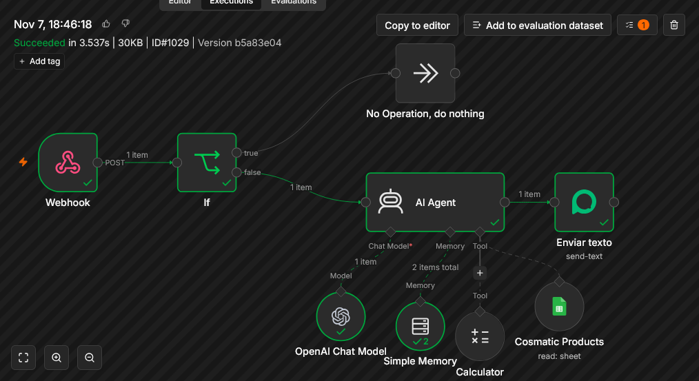

# 🚀 Autonomous WhatsApp AI Sales & Inventory Agent (n8n + Llama 3.3 + Google Sheets)

An end-to-end autonomous AI sales assistant built using **n8n (Self-Hosted)**, **Llama 3.3 70B (OpenRouter)**, **Google Sheets API**, and **Evolution API**. 

This agent connects directly to WhatsApp, handles customer sales inquiries in natural Roman Urdu, queries real-time stock levels, enforces store policies (location, delivery, payment), and guarantees **zero AI hallucinations**.

---

## ✨ Features
* 📦 **Live Inventory Fetching:** Queries live product stock, sizes, and pricing in PKR directly from Google Sheets.
* 🛡️ **Zero AI Hallucinations:** Strictly verifies product availability before confirming. If an item is missing, it politely informs the user.
* 💬 **Natural Roman Urdu Chat:** Speaks naturally in normal WhatsApp chatting style, greeting customers and answering FAQs smoothly.
* 🚚 **Policy & Knowledge Handling:** Answers queries regarding store location, nationwide Cash on Delivery (COD), delivery times (2-4 days), and payment methods (JazzCash, EasyPaisa, NayaPay).
* 🧮 **Multi-Item Billing:** Dynamically calculates total bill amounts when customers request multiple products.
* 🔒 **Enterprise Authentication:** Employs Google Cloud Service Account credentials for seamless, non-stop 24/7 API integration.

---

## 🛠️ Tech Stack & Prerequisites
* **Orchestration Engine:** n8n (Self-Hosted)
* **LLM Core:** Llama 3.3 70B Instruct via OpenRouter
* **Database / Inventory:** Google Sheets API (via Google Cloud Service Account)
* **WhatsApp Gateway:** Evolution API

---

## 🔄 End-to-End Execution Flow

1. **Webhook Ingestion:** Customer sends a WhatsApp message $\rightarrow$ Evolution API triggers an instant Webhook in n8n.
2. **Duplication Guard:** An `If Node` checks `fromMe == false` to isolate customer messages and prevent self-reply loops.
3. **Live Data Fetching:** When a user queries product details, the **AI Agent** executes the **Google Sheets Tool Node** (`Your Data`) to search live inventory.
4. **Automated Calculations:** If multiple items are requested, the AI uses the **Calculator Tool Node** to sum total costs accurately in PKR.
5. **Context Memory:** **Simple Memory (Window Buffer)** retains chat context bound to the customer's phone number (`remoteJid`).
6. **Message Outflow:** The generated response is passed to the **Evolution API Node** (`Enviar texto`), which dispatches the formatted reply back to the user's WhatsApp chat.

---

## ⚙️ Step-by-Step Setup & Node Credentials Guide

After importing `Whatsapp_Ai_Agent.json` into n8n, configure credentials for the following nodes:

### 1. Webhook Node
* **Path:** Default path is set to `whatsapp`.
* **Webhook URL:** Copy the production Webhook URL from n8n and paste it into your Evolution API instance configuration under `MESSAGES_UPSERT`.

### 2. OpenAI Chat Model Node (OpenRouter Setup)
* Click on the **OpenAI Chat Model** node.
* Under **Credential for OpenAI API**, create a new credential:
  * **API Key:** Paste your OpenRouter API Key (`sk-or-v1-...`).
  * **Base URL:** Enter `https://openrouter.ai/api/v1`
* **Model Selection:** Set Model Name to `meta-llama/llama-3.3-70b-instruct`.

### 3. Google Sheets Tool Node (`Your Data`)
* Click on the **Your Data** node.
* **Authentication:** Select `Service Account`.
* **Service Account Email & Private Key:** Create a project in Google Cloud Console, enable the Google Sheets API, generate a Service Account JSON key, and input the email and private key into n8n.
* **Document ID:** Paste your Google Sheet ID (found in your sheet URL between `/d/` and `/edit`).
* **Important:** Share your Google Sheet with your Service Account email address as an **Editor**.

### 4. Evolution API Node (`Enviar texto`)
* Click on the **Enviar texto** node.
* Create a new **Evolution API** credential:
  * **Server URL:** Your self-hosted Evolution API instance URL (e.g., `https://api.yourdomain.com`).
  * **API Key:** Your Evolution API Global Key / Instance Token.
* **Instance Name:** Ensure `instanceName` matches your active WhatsApp instance (`Wa_n8n`).

---

## 🎨 Customizing for Other Businesses (Retail, Restaurants, Services)

To adapt this AI Agent for any other store or business setup:

1. **Update System Prompt (AI Agent Node):**
   * Change store details, location, delivery charges, and payment options under `STORE KNOWLEDGE BASE`.
2. **Update Inventory Sheet:**
   * Replace the Google Sheet ID with your business sheet containing columns like `Product Name`, `Price`, `Size`, and `Stock Status`.

---

## 📌 Author & Developer
Developed by **Muhammad Danish**
* GitHub: [@Dani-Baba](https://github.com/Dani-Baba)
* Specialization: Full-Stack Web Development & AI Automation Engineering
